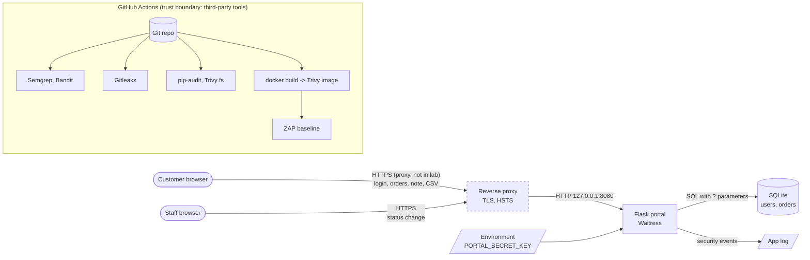

# Threat model — AgriSouss order portal (STRIDE)

> Lab application, synthetic data, never deployed. AgriSouss SARL is the same fictitious
> Moroccan agri e-commerce SME (~15 people) used in the other portfolio projects.
> Method: data flow diagram, then STRIDE per element, then the controls in
> [CONTROLS.md](CONTROLS.md). Written before the pipeline, updated after it.

## 1. Scope and assumptions

**What the portal does.** Business customers (cooperatives, shops) log in and see their own
orders (argan oil, saffron, dates...), add a delivery note, and export their orders to CSV.
AgriSouss staff see all orders and change their status.

**Assets.**

| Asset | Why it matters |
|---|---|
| Order data (who buys what, quantities, amounts in MAD, delivery notes) | Personal and commercial data: law 09-08 (CNDP) for natural persons, business secret for the rest |
| Customer and staff credentials | Account takeover leads to data theft or fake status changes |
| Session cookie | A stolen cookie = an authenticated session |
| `PORTAL_SECRET_KEY` | Signs sessions: whoever has it can forge any session, including staff |
| The CI pipeline and its tools | A compromised tool runs with access to the source and the CI token |

**Assumptions (out of scope, stated so they are not forgotten).**
- In a real deployment, a TLS reverse proxy (nginx / Caddy) sits in front and the app stays on
  127.0.0.1. In this lab there is no TLS: the browser talks HTTP to localhost.
- One Waitress process (the in-memory login throttle relies on it).
- No payment, no file upload, no e-mail sending in this version.

## 2. Data flow diagram

Trust boundaries: (1) browser to app — everything from the browser is untrusted, including
hidden fields, ids in URLs and cookies; (2) app to database; (3) the CI runner and the
external tools it downloads.

## 3. STRIDE

S = Spoofing, T = Tampering, R = Repudiation, I = Information disclosure, D = Denial of
service, E = Elevation of privilege. "Ctl" = control id in [CONTROLS.md](CONTROLS.md).

| # | Element | STRIDE | Threat (attacker story) | Ctl | Residual risk |
|---|---|---|---|---|---|
| T1 | Login | S | Online password guessing / credential stuffing on a customer account | C7, C8 | Throttle is per process and in memory; no MFA (gap G4) |
| T2 | Login | I | Username enumeration through different messages or response times | C8 | Generic message + dummy hash; not measured statistically |
| T3 | Session | S | Session fixation: attacker plants a session id before login | C6 | Low |
| T4 | Session | S/I | Cookie stolen by XSS or over plain HTTP | C5, C11, C12 | HTTP in the lab (G1) |
| T5 | Session | S | Forging a staff session | C13 | Depends on the secret staying secret (env var, no vault: G6) |
| T6 | Order detail / note | E/I | IDOR: customer changes `/orders/2` to `/orders/3` | C1 | Low; covered by tests, not by any scanner |
| T7 | Status change | E | Customer calls the staff-only status endpoint | C2 | Low |
| T8 | Any POST | T | CSRF: a malicious site makes a logged-in user's browser post a form | C4, C5 | Low |
| T9 | Note, product name | T/E | Stored XSS through the delivery note | C11, C12 | Low (autoescape + strict CSP) |
| T10 | Database | T/I | SQL injection through username, ids or note | C9 | Low |
| T11 | CSV export | T | CSV/formula injection: a note like `=HYPERLINK(...)` runs in the staff's spreadsheet | C10 | Spreadsheet behaviour varies (G7) |
| T12 | Login redirect | S | Open redirect `?next=https://evil` used in phishing | C14 | Low |
| T13 | Errors | I | Stack traces or versions leak in error pages and headers | C15, C16 | Low |
| T14 | Pages | I | Shared caches keep order pages | C17 | Low |
| T15 | Any request | D | Huge request bodies, slow hashing abused | C18, C8 | No global rate limit (G5) |
| T16 | Repository | I | A secret is committed (even "for testing") | C19 | Gitleaks rules are pattern-based (G8) |
| T17 | Dependencies | T/E | Known-vulnerable Flask/Werkzeug/Waitress or base image package | C20, C21 | Only *known* CVEs (G9) |
| T18 | CI tools | T/E | A security tool or action is hijacked (as Trivy was in March 2026) | C22 | Pins reduce, do not remove, the risk |
| T19 | Network | I | App reachable from the LAN while in debug | C15, C23 | Low |
| T20 | Actions | R | A staff member denies changing a status; no trace of failed logins | C24 | Logs are local text, not tamper-evident (G10) |

## 4. What the threat model told us to test

Scanners find *patterns* (a formatted SQL string, a missing header). Threats T6, T7 and T11
are *business logic*: no SAST or DAST tool knows that order 3 belongs to another customer.
That is why the most important tests in `tests/test_authz.py` were written by hand, and why
`scripts/mutation_check.py` proves that removing the ownership filter makes a test fail.
